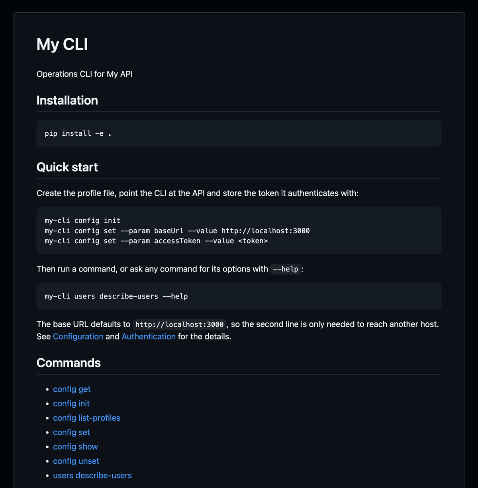


Generating a customizable CLI from your API spec should take a single click.

Existing generators are not enough.

That's why I built cli-wizard!



An [OpenAPI](https://www.openapis.org/) spec describes an API, and that is all well-established generators, such as [OpenAPI Generator](https://openapi-generator.tech/), need to generate a CLI that calls it.

However, those generators were not enough for one of my personal projects.
I wanted a customizable CLI, with a user experience like the [AWS CLI](https://aws.amazon.com/cli/), coming with its own documentation, tests, and packaged for immediate release on PyPI.

That is why I built [cli-wizard](https://pypi.org/project/cli-wizard/).
Give it a try

```
pip install cli-wizard
```

Check out the [official documentation](https://gmarciani.github.io/cli-wizard/) to learn more.
If you want it to do more, please [file a feature request](https://github.com/gmarciani/cli-wizard/issues).



## Bootstrap

You can bootstrap your project even before having an API spec:



The command generates:

- a config file `my-config.yaml` containing the full configuration, with every customization parameter available already listed at its default value, ready to be customized.
- A CLI ready to release, with a command to configure itself, its documentation, tests, and packaging.

The result is a functional CLI ready to be released:



## Add your API

Let's consider a simple API:



Regenerate the CLI:



Et voilà:



When the API changes, you regenerate the CLI.

## Documentation

The generated README documents the CLI: a quick start, every command with its options, the exit codes, the settings with their defaults, and how authentication works.



The project also comes with [Sphinx](https://www.sphinx-doc.org/) documentation in `docs/`, covering installation, every command with its options, the settings, authentication, and the exit codes.
`make build-docs` builds it, and with [`IncludeGithubWorkflows: true`](https://gmarciani.github.io/cli-wizard/configuration.html#cli_wizard.config.schema.Config.IncludeGithubWorkflows) a workflow publishes it to GitHub Pages.

## Release

The CLI is already packaged to be released to PyPi.
Doing it takes a build and an upload:



With [`IncludeGithubWorkflows: true`](https://gmarciani.github.io/cli-wizard/configuration.html#cli_wizard.config.schema.Config.IncludeGithubWorkflows),
the project also ships GitHub workflows to bump the version and publish to PyPI.

## Customize

cli-wizard exposes a bunch of customizations: command grouping, splash screen, logging format, colors, how requests are sent to the API, GitHub workflows, and more.
Check out the full set of parameters in the [parameter reference](https://gmarciani.github.io/cli-wizard/configuration.html#cli_wizard.config.schema.Config).
Here is a snippet to show you some of those customizations:


