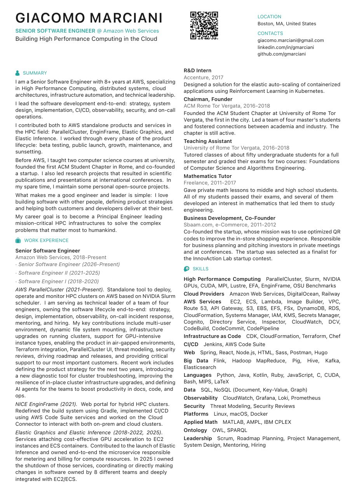
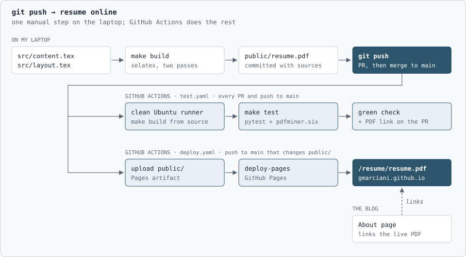


I ship my resume as a piece of software.


A resume is one of the most important artifacts we all own during our career. It decides whether anyone reads the rest.

This post is not about how to write the perfect resume. It is about how I maintain mine. 
A simple pipeline in [this GitHub repo](https://github.com/gmarciani/resume) builds, tests and publishes it.

## Requirements

- **Unique.** It stands out from the usual templates at a glance.
- **Content decoupled from layout.** Once I am happy with the layout, I only think about the content.
- **Readable by automated systems.** The software that reads it before any human extracts every word.
- **Easy to distribute.** One current version, at one URL, everywhere.
- **Easy to share.** Anyone holding a copy, even a printed one, can reach the latest version.

The first and the third pull in opposite directions. The pipeline is what holds all five.

## Unique

I am not sure whether my resume is good looking. 
What I am sure of is that the people who looked at it while hiring either liked it or hated it, but they remembered it. 
That is all I wanted from a creative layout: to stand out from a pile of equally valuable resumes.

The two columns go back to my university years. 
Working on scientific papers, I noticed how easy two-column text is to read, and I wanted the same for my resume. 
I also wanted it to carry the feel of a scientific paper, something that has always fascinated me. 
An accent color, an icon per section and a QR code complete the page.

## Content decoupled from layout

If you need to keep the content apart from the layout to generate a PDF, one tool stands out from the others: [LaTeX](https://www.latex-project.org/).

Getting a layout right takes hours. Once it is right, I do not want to think about it again. 
The resume is a LaTeX project split in two files. 
`layout.tex` holds the fonts, colors, columns and spacing. 
`content.tex` is a flat list of declarations such as `\job{title}{employer}{years}{description}`, with no formatting at all. 
Updating the resume means editing `content.tex` and nothing else: a new job is four arguments, and it lands in the right place with the right style. 
A restyle, when I want one, never touches the words, and `git diff` shows exactly what changed between two versions.

## Readable by automated systems

Machines read a resume before people do. 
Many job applications ask you to upload it and then autofill every field of the form from its text. 
Recruiters run it through resume checkers and [Applicant Tracking Systems](https://en.wikipedia.org/wiki/Applicant_tracking_system) to screen and rank candidates. 
A resume those systems cannot parse means a form to fill by hand at best, and a candidate silently filtered out at worst.

A parser does not see the layout. It extracts the text and rebuilds the reading order from glyph positions, which is exactly what a creative layout confuses. 
Mine needed a wider column gutter, so the two columns never merge, and looser justification, so lines never split mid-sentence.

A fix is only as good as the next edit, so the repo has tests. 
They run [pdfminer.six](https://github.com/pdfminer/pdfminer.six), the extractor behind common open-source resume parsers, on the built PDF and check that contacts, sections, jobs, descriptions and skills come out whole and in order. 
The expected values come from `content.tex`, so the tests follow every change. 
They are what let the layout stay unique: a version a parser cannot read never gets a green check.

## Easy to distribute

On every push, a GitHub Actions workflow builds the PDF from source on a clean runner and runs the tests. 
On every push to `main`, another publishes it to [GitHub Pages](https://gmarciani.github.io/resume/resume.pdf). 
The [About]() page of this blog links to that URL, not to a copy. 
One URL, always the latest version, no stale copies.

## Easy to share

A resume travels on paper as often as by email: a career fair, an interview printout, a stack on someone's desk. 
That is why the header carries a QR code pointing to [gmarciani.github.io/resume/resume.pdf](https://gmarciani.github.io/resume/resume.pdf). 
Anyone holding a printed copy is one scan away from the digital one, with working links. 
And since the URL never changes, the scan always lands on the latest version, even when the paper is a year old.

Updating my resume costs one commit. The pipeline does the rest.
