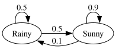
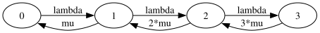


Solving a Markov chain shouldn't take a whiteboard and an afternoon.

Existing tools want the transition matrix in code.

That's why I built markov-solver!



A [Markov chain](https://en.wikipedia.org/wiki/Markov_chain) models a system that hops between states, where each move depends only on the current state.
Its steady-state probabilities tell you where the system spends its time, and from there the throughput, utilization, and response time of queues, networks, and computer systems, before you build them.

I met Markov chains while building [PyDES](https://github.com/gmarciani/pydes), a discrete-event simulator of a cloudlet offloading tasks to the cloud, for my performance modeling studies.
To validate it, I solved the same system as a Markov chain, with rates that depended on arrivals, service, and the number of servers.
By hand, the bookkeeping got brutal fast, so I wrote a solver, and that solver became markov-solver.
For the theory, start from [Discrete-Event Simulation](https://www.amazon.com/Discrete-Event-Simulation-Lawrence-M-Leemis/dp/0131429175) by Leemis and Park, and [Performance Modeling and Design of Computer Systems](https://www.amazon.com/Modeling-Simulation-Discrete-Event-Systems-ebook/dp/B00EMB3MXA) by Harchol-Balter.

Libraries like [PyDTMC](https://github.com/TommasoBelluzzo/PyDTMC) and [QuantEcon.py](https://quantecon.org/quantecon-py/) solve Markov chains too, but they want a numeric transition matrix in code.
I wanted to write a chain in a file, use symbolic rates, solve it from the terminal, and see it as a graph.
That is why I built [markov-solver](https://github.com/gmarciani/markov-solver).
It reads a chain in YAML, DOT, CSV, or JSON, computes its steady-state probabilities, draws it, and exports the results, from the CLI or from Python.

Give it a try:

```shell
pip install markov-solver
```

The [documentation](https://gmarciani.github.io/markov-solver/) has the details, and [feature requests](https://github.com/gmarciani/markov-solver/issues) are welcome.



## Solve a chain

A chain is a list of transitions between states.
Here is the weather, sunny or rainy from one day to the next:



Solve it:



You get the probabilities, the results as text and CSV, and the chain as a graph:



## Symbolic rates

Rates can be expressions of symbols you define once.
Here is a queue with arrivals at rate `lambda`, and service at a rate `mu` that grows with the jobs in the system:



markov-solver plugs in the symbols and solves:





## Other formats

The same chain also works as a Graphviz DOT file, a CSV adjacency matrix, or a transition matrix in YAML or JSON, and every format solves to the same result:







## Use it as a library

From Python, you can sweep parameters or feed the results into your own code.

Load a chain from a file:





Or build it in code, here the queue from above, for any number of jobs:





With `max_jobs = 3`, you get the same result as `queue.yaml`.
Set it to 10 for an eleven-state chain, with no file to write.
